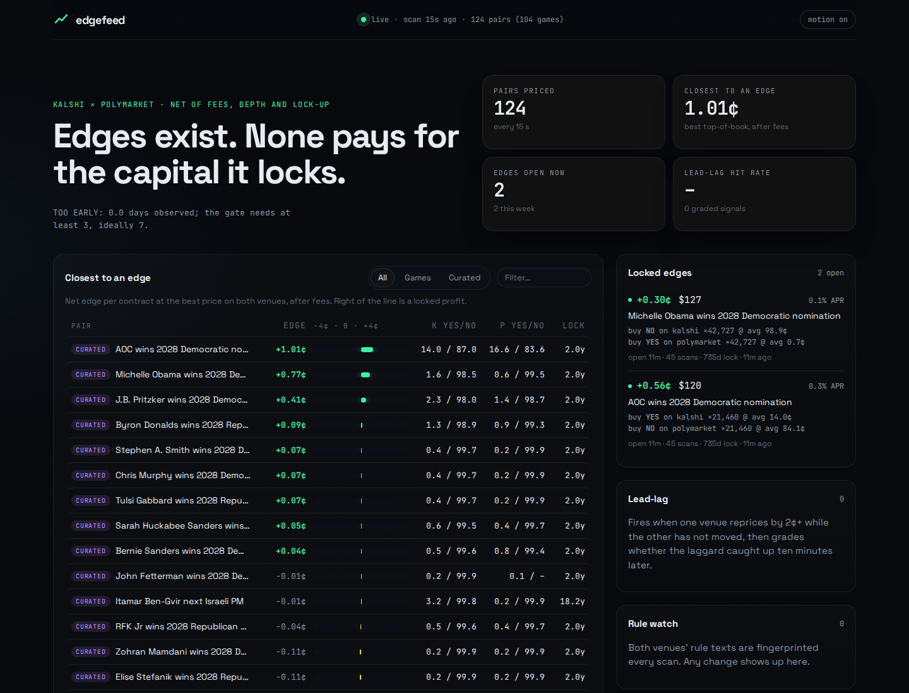
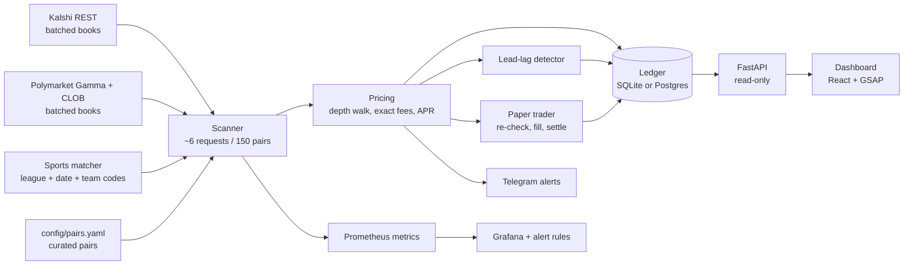

# EdgeFeed

[](https://github.com/Kage7047/edgefeed/actions/workflows/ci.yml)
[](https://github.com/Kage7047/edgefeed/actions/workflows/contract.yml)

Finds, prices and tracks cross-venue edges between **Kalshi** and **Polymarket**: two legs that
together pay $1 whatever happens, bought for less than $1 **after real fees, at real order-book
depth, and counted against the capital they lock until resolution.**

It answers one question with a ledger instead of a hunch: *do edges like that show up often
enough, last long enough to act on, and pay enough per dollar locked to be worth it?*



> **Analytics only, not financial advice.** EdgeFeed reads public market data. It holds no
> funds, has no trading keys and places no orders. Prediction markets carry risk and may be
> restricted where you live.

## What it has found so far

Measured on live data (details and method in [docs/FINDINGS.md](docs/FINDINGS.md)):

- **Long-dated political pairs do show locked edges, and they are worthless.** AOC for the 2028
  Democratic nomination: buy YES on Kalshi at 14¢, NO on Polymarket at ~84¢, about $120 of profit
  at full depth. Locked until November 2028, that is **0.3% a year**, below a savings account.
  The old spike reported these as wins because it ignored lock-up.
- **The old fee model was wrong both ways.** Kalshi rounds the fee up once per fill, not per
  contract (the spike overcounted by ~14% at 100 lots). Polymarket charges `rate × p × (1−p)`,
  not a flat category fee, so it is far cheaper away from 50¢.
- **Intra-venue "Dutch books" are not there.** No NO-basket edge across 4,773 mutually exclusive
  Kalshi events or 942 Polymarket neg-risk events. Polymarket "YES baskets" that look like 50–89¢
  edges are a trap: those events do not list every outcome.
- **Games are the real candidates.** 150+ games a day match exactly across venues (NBA, NHL,
  NCAAB, European soccer). They resolve within a day, so even a 1¢ edge is a large APR, but
  pre-game they sit ~4¢ *below* an edge on average: fees are ~3¢ at even odds. In play is
  different: the first night caught a 5.9¢ edge (~$150 at depth) on a Champions League game that
  was gone 15 seconds later. Live games are now scanned every 3 seconds, and every edge is
  re-checked and paper-traded to find out whether it could really have been taken.

## How it works



- **Exact fees.** Kalshi: `round_up(0.07 × C × P × (1−P))` per fill, times the series
  `fee_multiplier` from its API. Polymarket: `C × rate × p × (1−p)` with each market's own
  `feeSchedule` (geopolitics is 0). Sources and dates are in `src/edgefeed/fees.py`.
- **Depth, not top of book.** Both ask ladders are walked together; profit is concave in size,
  so the walk stops at the first step that loses money and keeps the most profitable size. A
  property test checks it against brute force over every size.
- **Capital lock-up.** APR = profit ÷ capital × 365 ÷ days until the *later* of the two
  resolutions. Alerts require ≥10% APR and ≥$5 by default.
- **Settlement risk is surfaced, not hidden.** Both venues' rule texts are fingerprinted every
  scan, and any change raises an event. Known differences are attached to each pair, e.g. a
  postponed game: Kalshi pays a fair price after 48 hours, Polymarket waits or pays 50-50.
- **Opportunity lifecycle.** Each edge is opened, updated while it lasts and closed when it
  disappears, so the ledger knows how long edges live. A pair that fails to fetch is *unknown*,
  not closed.
- **Hot scans.** Full scans run every 15s. In between, games in play (from 20 minutes before
  start) and pairs with an open edge are re-scanned every 3s, in ~0.4s per scan.
- **Paper trading.** Each new edge is re-fetched straight away and "taken" at 200 contracts if it
  is still there, or logged as missed. Open paper trades are settled from both venues' real
  results, and a hedge that does not pay $1 per contract raises a settlement-mismatch event. Fill
  rate and settled P&L are the go/no-go numbers. Nothing is ever ordered.
- **Carry.** Polymarket holding rewards (4% on flagged long-dated markets) and, if you are
  eligible, Kalshi interest on positions are added to APR.
- **Lead-lag.** When one venue moves 2¢+ and the other has not, a signal is logged and graded ten
  minutes later: did the laggard converge (hit), or did the leader snap back (revert)? Only books
  at most 4¢ wide count; wide books made 90% of the first night's signals noise.

## Run it

```bash
make install                      # uv venv + package
.venv/bin/edgefeed scan --sports  # one table: curated pairs + today's games
make run                          # collector + dashboard on http://127.0.0.1:8090 (SQLite)
.venv/bin/edgefeed report         # go / no-go from the ledger
```

24/7 on a Linux box without root: `make service` (systemd user units). In Docker with Postgres:
`docker compose up -d`; add `--profile monitoring` for Prometheus (:9090) and a provisioned
Grafana dashboard (:3000). Settings are `EDGEFEED_*` environment variables, listed in
[.env.example](.env.example); Telegram alerts switch on when a bot token and chat id are set.

## Engineering

- `mypy --strict` on the package, ruff, 65+ tests: fee rules from the venues' own worked
  examples, property tests (Hypothesis) for the depth walk, recorded API fixtures, mocked HTTP
  (retries, `Retry-After`, no retry on 4xx), the full ledger lifecycle, and the API.
- The same ledger tests run on **Postgres** in CI, and the job fails if they were skipped.
- **Contract tests run daily against the live APIs.** Kalshi renamed every price field in
  2025-26; a rename now fails CI instead of silently zeroing the collector.
- Docker image built and smoke-tested in CI; gitleaks on every push.
- Schema changes upgrade an existing ledger in place (`Store.migrate`, additive and nullable
  only; anything else is refused).
- Prometheus metrics (scan time, venue errors and latency, pairs failing, closest edges) with
  alert rules for a stalled collector, failing venues and API drift.

Design decisions are written up in [docs/adr](docs/adr). The original validation spike is kept
in [research/](research/) with a table of what changed and why.

## Next

- WebSocket feeds, if the paper miss rate shows 3 seconds is too slow (Polymarket's market
  channel is public; Kalshi's needs an RSA-signed key).
- Better NHL and NCAAB matching (17/30 and 12/160 games today): team-code aliases.
- More venues to widen the overlap.
- Matching for economics (Fed, CPI) and crypto ranges, where strikes differ and need mapping.

MIT licensed.
